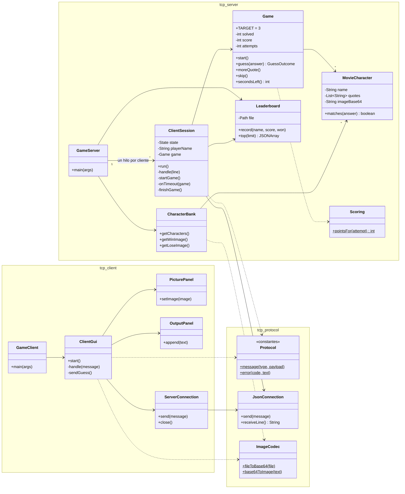
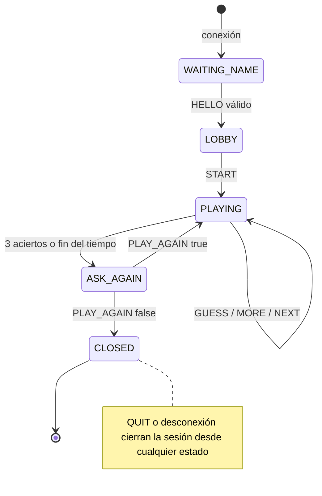
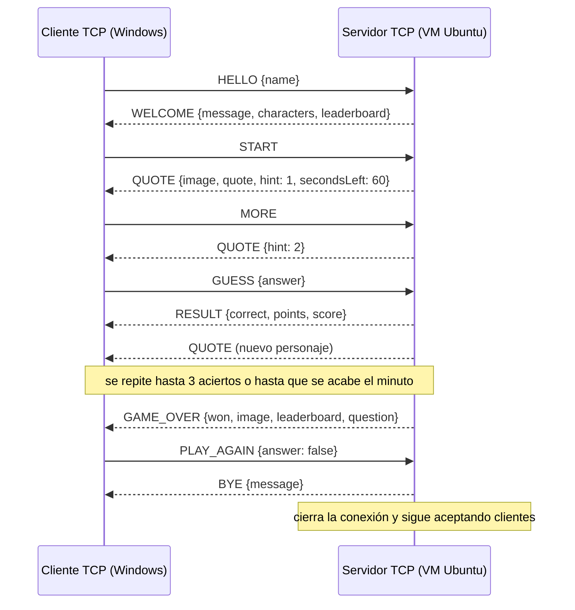
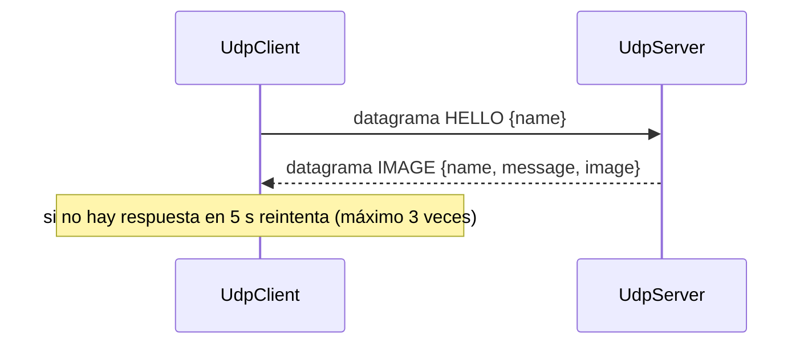

# ¿Quién lo dijo? — Juego cliente-servidor con TCP, UDP y JSON

Aprendizaje Autónomo 2 · Principios de sistemas de software distribuido (UIDE, 1-SOF-5A) · Heraldo

## 1. Descripción general

Juego cliente-servidor en Java donde el jugador debe adivinar qué personaje de película dijo una frase. El servidor guarda los personajes, sus frases y sus imágenes, controla el tiempo y los puntos, y lleva el marcador. El cliente es una ventana donde se ve la imagen y la frase, y desde donde se envían las respuestas.

El proyecto tiene dos implementaciones separadas:

- **`tcp/`**: el juego completo. Cliente y servidor se comunican por TCP con un protocolo propio en JSON.
- **`udp/`**: una versión reducida. El cliente envía su nombre y el servidor responde con una imagen.

**Cómo se juega:**

1. El jugador escribe su nombre. El servidor lo saluda, muestra los personajes en juego y el marcador.
2. Al pulsar **Jugar** empieza el minuto. El servidor envía la imagen y una frase de un personaje al azar.
3. El jugador usa tres comandos:
   - **guess**: envía el nombre del personaje. Si acierta, suma puntos y pasa a otro personaje.
   - **more**: pide otra frase del mismo personaje. Cada personaje tiene 4 frases.
   - **next**: salta a otro personaje sin sumar puntos.
4. Si acierta 3 personajes antes de 60 segundos, gana y recibe la imagen de felicitaciones. Si se acaba el tiempo, pierde y recibe la imagen de derrota, aunque no haya hecho nada en ese momento.
5. El servidor pregunta si quiere jugar otra vez. Si la respuesta es no, cierra la conexión y sigue aceptando clientes nuevos.

Las respuestas no distinguen mayúsculas, tildes ni signos, y se aceptan nombres alternativos (por ejemplo "Vader" o "Darth Vader").

La interfaz gráfica es propia, con las clases `ClientGui`, `PicturePanel` y `OutputPanel` que piden los requisitos. El docente aprobó no usar el código base adjunto en Canvas, que corresponde a otra actividad.

## 2. Checklist de requisitos

| Requisito | Estado | Dónde está |
|---|---|---|
| Juego cliente-servidor por TCP con protocolo propio en JSON | Cumplido | `tcp/` |
| Personajes con 4 frases y una imagen cada uno (6 personajes) | Cumplido | `tcp/src/main/resources/personajes.json`, `img/` |
| El servidor envía una imagen con una frase | Cumplido | mensaje `QUOTE` |
| Comandos guess, more y next | Cumplido | mensajes `GUESS`, `MORE`, `NEXT` |
| 1 minuto para adivinar 3 frases | Cumplido | `Game`, temporizador en `ClientSession` |
| Imagen de felicitaciones al ganar y de derrota al perder | Cumplido | `img/ganaste.png`, `img/perdiste.png`, mensaje `GAME_OVER` |
| Pregunta si desea continuar; si no, cierra y queda disponible para otro cliente | Cumplido | `PLAY_AGAIN`, `BYE`; un hilo por cliente |
| Versión UDP: el cliente envía su nombre y el servidor responde con una imagen | Cumplido | `udp/` |
| Carpetas `tcp/`, `udp/` e `img/` | Cumplido | raíz del proyecto |
| Ejecución con Gradle y valores por defecto localhost y 8080 | Cumplido | `build.gradle` de cada carpeta |
| Protocolo con tipos de mensaje, payload y mensajes de error | Cumplido | sección 6 |
| Interfaz gráfica integrada con la red | Cumplido | `tcp/src/main/java/tcp/client/` |
| Puntos según el número de intentos | Cumplido | `Scoring` |
| Marcador al inicio y al final de la partida | Cumplido | mensajes `WELCOME` y `GAME_OVER` |
| Marcador persistente en archivo (puntos extra) | Cumplido | `leaderboard.json`, clase `Leaderboard` |
| Manejo de errores sin que se caiga el servidor | Cumplido | sección 8 |
| README con descripción, checklist, instrucciones, UML y protocolo | Cumplido | este archivo |
| Video de demostración | Cumplido | adjunto en la entrega de Canvas |

## 3. Requisitos para ejecutar

- Java 17 o superior. Se probó con Java 17 en una máquina virtual Ubuntu y con Java 24 en Windows.
- No hace falta instalar Gradle: el proyecto incluye el wrapper (`gradlew` y `gradlew.bat`). La primera vez descarga Gradle 8.14.3 y la librería `org.json`, así que necesita internet.
- El equipo del servidor debe permitir conexiones en el puerto 8080, por TCP y por UDP.

## 4. Cómo compilar y ejecutar

Todos los comandos se ejecutan desde la carpeta del proyecto (`Autonomo2`).

**Compilar:**

```bash
./gradlew build
```

**Juego completo (TCP):**

```bash
./gradlew :tcp:runServer --console=plain     # servidor: puerto 8080, partidas de 60 segundos
./gradlew :tcp:runClient --console=plain     # cliente: se conecta a localhost:8080
```

**Versión UDP:**

```bash
./gradlew :udp:runServer --console=plain     # servidor UDP en el puerto 8080
./gradlew :udp:runClient --console=plain     # cliente UDP: pide el nombre y muestra la imagen
```

**Parámetros opcionales:**

| Parámetro | Para qué sirve | Valor por defecto |
|---|---|---|
| `-Phost=IP` | Servidor al que se conecta el cliente | `localhost` |
| `-Pport=N` | Puerto del servidor o del cliente | `8080` |
| `-Pseconds=N` | Duración de la partida (servidor TCP) | `60` |
| `-Pplayer=Nombre` | Nombre del jugador sin abrir el cuadro de diálogo (cliente UDP) | se pide en pantalla |

**Ejemplo con el servidor en otro equipo** (servidor en 192.168.0.164):

```bash
./gradlew :tcp:runClient -Phost=192.168.0.164
./gradlew :udp:runClient -Phost=192.168.0.164 -Pplayer=Luis
```

**En Windows (PowerShell)** se usa `gradlew.bat`, y los parámetros con IP van entre comillas, porque PowerShell corta el texto en el primer punto:

```powershell
.\gradlew.bat :tcp:runClient "-Phost=192.168.0.164"
.\gradlew.bat :udp:runClient "-Phost=192.168.0.164" "-Pplayer=Luis"
```

## 5. Diseño (UML)

### 5.1. Diagrama de clases del juego TCP



Los diagramas también están como imagen en la carpeta `uml/`.

| Clase | Qué hace |
|---|---|
| `GameServer` | Abre el puerto y crea un hilo `ClientSession` por cada cliente que se conecta. |
| `ClientSession` | Atiende a un cliente: lee sus mensajes, aplica las reglas según el estado de la sesión y responde. |
| `Game` | Guarda el estado de una partida: personaje actual, frase, intentos, aciertos, puntos y tiempo. |
| `MovieCharacter` | Un personaje: nombre, nombres aceptados, 4 frases e imagen. |
| `CharacterBank` | Carga los personajes desde `personajes.json` y las imágenes desde `img/`. |
| `Leaderboard` | Marcador guardado en `leaderboard.json`. |
| `Scoring` | Fórmula de puntos según el intento. |
| `Protocol` | Tipos de mensaje y códigos de error del protocolo. |
| `JsonConnection` | Envía y recibe mensajes JSON por el socket, uno por línea. |
| `ImageCodec` | Convierte imágenes a Base64 para enviarlas dentro del JSON, y al revés. |
| `ClientGui` | Ventana del juego: muestra lo que llega del servidor y envía los comandos. |
| `PicturePanel` | Panel que muestra la imagen recibida. |
| `OutputPanel` | Historial de mensajes, caja de respuesta y botones de los comandos. |
| `ServerConnection` | Conexión del cliente; un hilo escucha los mensajes del servidor. |

### 5.2. Estados de la sesión en el servidor



Si llega un comando que no corresponde al estado actual (por ejemplo `GUESS` antes de `START`), el servidor responde con el error `INVALID_STATE` y la sesión sigue igual.

### 5.3. Flujo de una partida



## 6. Protocolo JSON (TCP)

### 6.1. Formato general

Todos los mensajes tienen la misma forma:

```json
{"type": "TIPO_DE_MENSAJE", "payload": { ...campos... }}
```

- `type` es el encabezado: indica qué mensaje es.
- `payload` lleva los datos del mensaje. En los mensajes sin datos puede ir vacío (`{}`) u omitirse.
- Cada mensaje viaja como **una línea de texto en UTF-8** terminada en salto de línea.
- Las imágenes viajan dentro del JSON como texto **Base64** (archivos PNG).
- Un mensaje del cliente puede tener como máximo 4096 caracteres. Los mensajes más largos se descartan con el error `INVALID_JSON`.

### 6.2. Mensajes del cliente al servidor

| type | Campos del payload | Cuándo se usa |
|---|---|---|
| `HELLO` | `name` (texto, de 1 a 20 caracteres) | Al conectarse, para presentarse |
| `START` | (ninguno) | Para empezar una partida |
| `GUESS` | `answer` (texto) | Para intentar adivinar el personaje |
| `MORE` | (ninguno) | Para pedir otra frase del mismo personaje |
| `NEXT` | (ninguno) | Para saltar a otro personaje |
| `PLAY_AGAIN` | `answer` (true/false; también acepta "si"/"no") | Para responder si quiere jugar otra vez |
| `QUIT` | (ninguno) | Para salir en cualquier momento |

### 6.3. Mensajes del servidor al cliente

| type | Campos del payload | Cuándo se envía |
|---|---|---|
| `WELCOME` | `message`, `characters` (lista de nombres), `leaderboard` (lista) | Después de un `HELLO` válido |
| `QUOTE` | `image` (Base64), `quote`, `hint` (1 a 4), `hintsTotal`, `solved`, `target`, `score`, `secondsLeft`, `message` | Al empezar, tras `MORE`, tras `NEXT` y tras cada acierto |
| `RESULT` | `correct`, `points`, `score`, `solved`, `attempts`, `message` | Después de cada `GUESS` |
| `GAME_OVER` | `won`, `image` (Base64), `score`, `solved`, `message`, `leaderboard`, `question` | Al lograr 3 aciertos, o al acabarse el minuto (lo envía el servidor sin que el cliente pregunte) |
| `BYE` | `message` | Antes de cerrar la conexión |
| `ERROR` | `code`, `message` | Cuando un mensaje no se puede procesar |

Cada elemento de `leaderboard` tiene `position`, `name`, `bestScore`, `wins` y `games`.

### 6.4. Códigos de error

| code | Cuándo ocurre |
|---|---|
| `INVALID_JSON` | El mensaje no es un JSON válido, o supera los 4096 caracteres |
| `MISSING_FIELD` | Falta un campo obligatorio: `type`, `answer` en `GUESS`, o `answer` true/false en `PLAY_AGAIN` |
| `UNKNOWN_TYPE` | El `type` no existe en el protocolo |
| `INVALID_STATE` | El comando no corresponde al momento del juego (por ejemplo `GUESS` antes de `START`, o `START` con una partida en curso) |
| `NO_MORE_HINTS` | Se pidió `MORE` después de ver las 4 frases del personaje |
| `INVALID_NAME` | Nombre vacío o de más de 20 caracteres |
| `SERVER_ERROR` | Error inesperado del servidor; la sesión sigue funcionando |

Después de cualquier error la conexión sigue abierta y el jugador puede continuar.

### 6.5. Ejemplos de mensajes

Ejemplos de una sesión con el servidor. El texto Base64 de las imágenes está recortado; el personaje, la frase y el tiempo cambian en cada partida.

**Presentarse:**

```json
{"type": "HELLO", "payload": {"name": "Luis"}}
```
```json
{"type": "WELCOME", "payload": {"message": "Hola Luis, bienvenido a ¿Quién lo dijo? Tienes 60 segundos para adivinar 3 personajes. Pulsa Jugar para empezar.", "characters": ["Darth Vader", "Yoda", "Gandalf", "Forrest Gump", "Terminator", "Buzz Lightyear"], "leaderboard": []}}
```

**Empezar la partida:**

```json
{"type": "START", "payload": {}}
```
```json
{"type": "QUOTE", "payload": {"image": "iVBORw0KGgoAAAANSUhEUgAA...", "quote": "Mi mamá siempre decía que la vida es como una caja de chocolates: nunca sabes lo que te va a tocar.", "hint": 1, "hintsTotal": 4, "solved": 0, "target": 3, "score": 0, "secondsLeft": 60, "message": "¡Comienza la partida! Tienes 60 segundos para acertar 3 personajes."}}
```

**Pedir otra frase:**

```json
{"type": "MORE", "payload": {}}
```
```json
{"type": "QUOTE", "payload": {"image": "iVBORw0KGgoAAAANSUhEUgAA...", "quote": "Tonto es el que hace tonterías.", "hint": 2, "hintsTotal": 4, "solved": 0, "target": 3, "score": 0, "secondsLeft": 52, "message": "Otra frase del mismo personaje (2 de 4)."}}
```

**Respuesta incorrecta y luego correcta:**

```json
{"type": "GUESS", "payload": {"answer": "Shrek"}}
```
```json
{"type": "RESULT", "payload": {"correct": false, "points": 0, "score": 0, "solved": 0, "attempts": 1, "message": "\"Shrek\" no es correcto. Intenta otra vez, pide otra frase (more) o salta (next)."}}
```
```json
{"type": "GUESS", "payload": {"answer": "Forrest Gump"}}
```
```json
{"type": "RESULT", "payload": {"correct": true, "points": 7, "score": 7, "solved": 1, "attempts": 2, "message": "¡Correcto! Era Forrest Gump. Ganaste 7 puntos en el intento 2."}}
```

**Saltar de personaje:**

```json
{"type": "NEXT", "payload": {}}
```
```json
{"type": "QUOTE", "payload": {"image": "iVBORw0KGgoAAAANSUhEUgAA...", "quote": "Volveré.", "hint": 1, "hintsTotal": 4, "solved": 1, "target": 3, "score": 7, "secondsLeft": 41, "message": "Saltaste al siguiente personaje."}}
```

**Fin de la partida (victoria):**

```json
{"type": "GAME_OVER", "payload": {"won": true, "image": "iVBORw0KGgoAAAANSUhEUgAA...", "score": 27, "solved": 3, "message": "¡Felicitaciones! Acertaste 3 personajes en 34 segundos. Puntaje: 27.", "leaderboard": [{"position": 1, "name": "Luis", "bestScore": 27, "wins": 1, "games": 1}], "question": "¿Quieres jugar otra vez?"}}
```

**No seguir jugando:**

```json
{"type": "PLAY_AGAIN", "payload": {"answer": false}}
```
```json
{"type": "BYE", "payload": {"message": "Gracias por jugar, Luis. ¡Hasta pronto!"}}
```

**Mensajes de error:**

| Lo que envía el cliente | Lo que responde el servidor |
|---|---|
| `hola servidor` | `{"type": "ERROR", "payload": {"code": "INVALID_JSON", "message": "El mensaje no es un JSON válido"}}` |
| `{"type": "JUGAR"}` | `{"type": "ERROR", "payload": {"code": "UNKNOWN_TYPE", "message": "Tipo de mensaje desconocido: JUGAR"}}` |
| `{"type": "HELLO", "payload": {"name": ""}}` | `{"type": "ERROR", "payload": {"code": "INVALID_NAME", "message": "El nombre debe tener entre 1 y 20 caracteres"}}` |
| `{"type": "GUESS", "payload": {"answer": "Yoda"}}` antes de enviar START | `{"type": "ERROR", "payload": {"code": "INVALID_STATE", "message": "No hay partida en curso; envía START para empezar"}}` |
| `{"type": "MORE"}` después de la cuarta frase | `{"type": "ERROR", "payload": {"code": "NO_MORE_HINTS", "message": "Ya viste las 4 frases de este personaje. Adivina (guess) o salta (next)."}}` |

## 7. Protocolo UDP (versión reducida)



- Cada mensaje es un datagrama UDP con un JSON del mismo formato `{"type", "payload"}`.
- El cliente envía `HELLO` con `name`. El servidor responde `IMAGE` con `name`, `message` e `image` (Base64).
- La imagen se elige según el nombre: el mismo nombre recibe siempre la misma tarjeta (hay 4, `img/udp_1.png` a `img/udp_4.png`).
- La respuesta completa debe caber en un solo datagrama (máximo 65 507 bytes). Las imágenes miden unos 5 KB, y la respuesta ocupa unos 6,7 KB.
- Como UDP no garantiza la entrega, el cliente espera 5 segundos y reintenta hasta 3 veces.
- Errores: `INVALID_JSON`, `MISSING_FIELD`, `UNKNOWN_TYPE` (cualquier tipo distinto de `HELLO`) e `INVALID_NAME`.

```json
{"type": "HELLO", "payload": {"name": "Luis"}}
```
```json
{"type": "IMAGE", "payload": {"name": "Luis", "message": "Hola Luis, esta es tu imagen (tarjeta 4 de 4)", "image": "iVBORw0KGgoAAAANSUhEUgAA..."}}
```

## 8. Puntos, marcador y robustez

**Puntos.** Cada acierto vale según el número de intentos con ese personaje:

| Intento | Puntos |
|---|---|
| 1 | 10 |
| 2 | 7 |
| 3 | 4 |
| 4 o más | 1 |

Pedir otra frase (`more`) no resta puntos; saltar (`next`) no suma.

**Marcador.** Guarda por jugador su mejor puntaje, sus victorias y sus partidas jugadas, ordenado por mejor puntaje. Se muestra al conectarse (`WELCOME`) y al terminar cada partida (`GAME_OVER`). Se guarda en `leaderboard.json`, en la carpeta del proyecto, así que no se pierde al apagar el servidor. Para guardar, primero escribe un archivo temporal y luego lo reemplaza, para no dejar el archivo a medias.

**Robustez y manejo de errores:**

- Ningún mensaje inválido hace caer al servidor: responde con `ERROR` y la sesión continúa.
- Cada cliente se atiende en su propio hilo. Si un cliente se desconecta de golpe, solo se cierra su sesión y el servidor sigue aceptando clientes.
- El temporizador corre en el servidor. Al acabarse el minuto envía `GAME_OVER` aunque el jugador no haga nada.
- Los métodos que cambian el estado de la sesión están sincronizados, porque el temporizador corre en otro hilo.
- Si el servidor no está encendido o se pierde la conexión, el cliente lo avisa con un mensaje en pantalla en lugar de cerrarse con un error.
- Si falta una imagen o el archivo de personajes está mal escrito, el servidor lo indica al arrancar.

## 9. Estructura del proyecto

```
Autonomo2/
├── README.md
├── build.gradle            configuración común (Java 17, org.json, host y puerto por defecto)
├── settings.gradle         incluye los proyectos tcp y udp
├── gradlew, gradlew.bat    Gradle incluido
├── img/                    imágenes de personajes, victoria, derrota y tarjetas UDP
├── uml/                    diagramas UML (fuente Mermaid e imagen PNG)
├── tcp/
│   ├── build.gradle        tareas runServer y runClient
│   └── src/main/
│       ├── java/tcp/protocol/   Protocol, JsonConnection, ImageCodec
│       ├── java/tcp/server/     GameServer, ClientSession, Game, MovieCharacter, CharacterBank, Leaderboard, Scoring
│       ├── java/tcp/client/     GameClient, ClientGui, PicturePanel, OutputPanel, ServerConnection
│       └── resources/personajes.json
└── udp/
    ├── build.gradle        tareas runServer y runClient
    └── src/main/java/udp/   server/UdpServer, client/UdpClient
```

Las imágenes del juego son propias, hechas para este proyecto. Para cambiar un personaje o una frase basta con editar `personajes.json`; para cambiar una imagen, reemplazar el archivo en `img/` con el mismo nombre.

## 10. Video de demostración

El video está adjunto en la entrega de Canvas. Muestra el servidor corriendo en una máquina virtual Ubuntu (192.168.0.164) y el cliente en una PC con Windows (192.168.0.208), en la misma red local: inicio de sesión, una partida, victoria y derrota, el marcador y la versión UDP.
